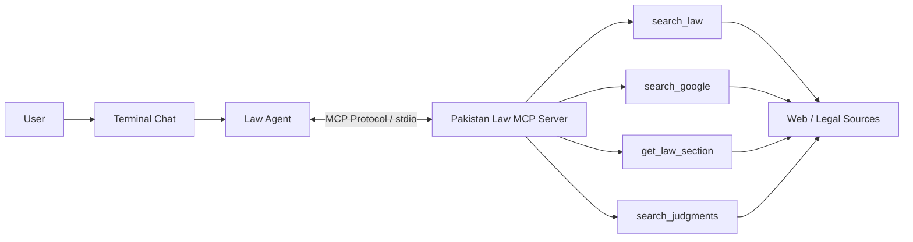

# Pakistan Law MCP + Agent Demo

A clean, classroom-friendly **Pakistan Law AI assistant** designed to teach AI Solutions Engineering students how an AI agent uses tools exposed through a **Model Context Protocol (MCP)** server.

---

## 1. What is this?

This project demonstrates the core architectural flow:

```text
User ──> Terminal Chat ──> Law Agent ──(MCP Protocol)──> MCP Server ──> Tools ──> Legal Web Sources
```

Instead of directly importing Python functions into the agent code, the agent connects as a standard **MCP Client** to a standalone **MCP Server** (`mcp/server.py`) over standard input/output (`stdio`), dynamically discovers available tools, and executes them on demand based on user queries.

---

## 2. Architecture



### Key Components

* **`mcp/server.py` (MCP Server)**: Built with official FastMCP (`mcp.server`). Exposes 4 tools:
  * `search_law(query: str)`: Searches Pakistani statutes, acts, ordinances, and legal provisions (PECA, PPC, Constitution, CrPC, etc.).
  * `search_google(query: str)`: Performs live Google web search via Serper API for general/current queries.
  * `get_law_section(section: str, law_name: str)`: Retrieves authoritative statutory provisions (e.g. Section 489-F PPC, Section 20 PECA) with verified legal text and official URLs.
  * `search_judgments(query: str)`: Queries Pakistani court judgments and case law precedents (Supreme Court, High Courts).
* **`agents/law_agent.py` (Law Agent)**: Connects to the MCP server over `stdio` using `stdio_client` and `ClientSession`. Dynamically lists available tools, maps their JSON schemas to OpenAI function calling specifications, and orchestrates multi-turn conversation memory.
* **`app.py` (Terminal Chat)**: Interactive terminal UI where students can chat with the assistant and observe live tool calls.

---

## 3. How the MCP Connection Works

1. When `app.py` launches, `LawAgent.connect()` spawns `mcp/server.py` as a sub-process via `mcp.client.stdio.stdio_client`.
2. Communication occurs purely via JSON-RPC messages transmitted over the sub-process's `stdin` and `stdout`.
3. The agent calls `session.list_tools()` to discover available tools.
4. When the user asks a question, the LLM decides which tool to call.
5. In the terminal, students see the interaction:
   ```text
   [Agent -> MCP] get_law_section
   [MCP -> Agent] Tool result received
   ```
6. The agent feeds the tool output back to the LLM to generate the final verified response.

---

## 4. Installation & Setup

### Step 1: Clone or Navigate to the Project

```bash
cd pakistan-law-mcp
```

### Step 2: Create and Activate a Virtual Environment

**Windows (PowerShell):**
```powershell
python -m venv .venv
.venv\Scripts\Activate.ps1
```

**Windows (Command Prompt):**
```cmd
python -m venv .venv
.venv\Scripts\activate.bat
```

**macOS / Linux:**
```bash
python3 -m venv .venv
source .venv/bin/activate
```

### Step 3: Install Dependencies

```bash
pip install -r requirements.txt
```

### Step 4: Configure Environment Variables

Copy `.env.example` to `.env`:

**Windows (PowerShell):**
```powershell
Copy-Item .env.example .env
```

**macOS / Linux:**
```bash
cp .env.example .env
```

Edit `.env` with your API keys:

```env
OPENAI_API_KEY=your_openai_api_key_here
OPENAI_MODEL=gpt-4o-mini
SERPER_API_KEY=your_serper_api_key_here
```

* `OPENAI_API_KEY`: Required for the LLM agent to understand questions and trigger tools.
* `OPENAI_MODEL`: Optional. Defaults to `gpt-4o-mini`.
* `SERPER_API_KEY`: Optional. Used for live Google web searches via Serper (https://serper.dev). If not provided, the server utilizes its built-in verified statutory legal database.

---

## 5. Running the Application

Start the interactive terminal chat:

```bash
python app.py
```

You will see:

```text
Connected to MCP server.

Available tools:
- search_law
- search_google
- get_law_section
- search_judgments

========================================
      Pakistan Law AI Assistant
========================================

Ask a question about Pakistani law.
Type 'exit' to quit.

You:
```

Type `exit` or `quit` anytime to terminate the session.

---

## 6. Example Questions for Classroom Demonstrations

Test these questions to observe how the agent selects different tools:

### 1. Specific Legal Section (triggers `get_law_section`)
> **"What is Section 489-F of the Pakistan Penal Code?"**  
> *Agent selects `get_law_section(section="489-F", law_name="Pakistan Penal Code")` and returns the exact statutory text, punishment, and official Pakistan Code URL.*

### 2. Statute Overview (triggers `search_law`)
> **"What does PECA say about cyber harassment?"**  
> *Agent selects `search_law(query="PECA cyber harassment")` and highlights Section 20, 21, and 24.*

### 3. Court Precedents / Judgments (triggers `search_judgments`)
> **"Are there important Pakistani court judgments about cyber harassment?"**  
> *Agent selects `search_judgments(query="cyber harassment Pakistan Supreme Court")` and reports landmark rulings such as PFUJ v. Federation of Pakistan (PLD 2022 Islamabad 408).*

### 4. Recent Developments (triggers `search_google`)
> **"Search for recent information about Pakistani cybercrime law updates in 2026."**  
> *Agent selects `search_google(query="Pakistan cybercrime law updates 2026")`.*

### 5. Multi-turn Follow-up (demonstrating conversation memory)
> **You:** "What is PECA?"  
> **Agent:** *(Explains Prevention of Electronic Crimes Act 2016)*  
> **You:** "What does Section 20 say?"  
> **Agent:** *(Understands context and calls `get_law_section(section="20", law_name="PECA")`)*

---

## 7. Educational Safety & Disclaimers

This assistant includes strict safety guardrails:
* **Anti-hallucination:** If a section or case cannot be verified through official sources or search tools, the server explicitly informs the user rather than inventing legal text.
* **Educational Disclaimer:** Every substantive legal answer includes:
  > *"Note: This is general legal information for educational purposes and is not legal advice. Verify the cited law or consult a qualified Pakistani lawyer for advice about a specific situation."*
